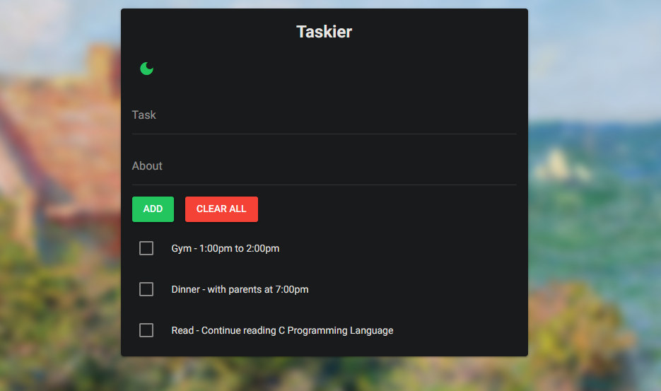

# Taskier

A simple task manager built with Python, SQLite and NiceGUI. Add tasks, mark them as done, and delete them, from a web interface or from the terminal.
Taskier is a project made by a student, and it's in early development.



## Features

- Add tasks with a title and a description
- Mark tasks as done (and undo it)
- Delete a single task or clear all of them
- Tasks are saved in a local SQLite database
- Two interfaces sharing the same logic: a web UI and a terminal menu

## Requirements

- Python 3.12 or 3.13
- [NiceGUI](https://nicegui.io)

## Installation

```
git clone https://github.com/YOUR-USERNAME/Taskier.git
cd Taskier
python -m venv .venv
.venv\Scripts\activate
pip install nicegui
```

(On macOS/Linux, activate with `source .venv/bin/activate`.)

## Usage

Web interface:

```
python app.py
```

Then open http://localhost:8080 if it doesn't open automatically.

Terminal version:

```
python main.py
```

## Project structure

- `tasks.py`: database and task functions, shared by both interfaces
- `app.py`: NiceGUI web interface
- `main.py`: terminal menu interface

## About

Learning project to practice Python, SQLite and building a UI. Ideas for the future: editing tasks, due dates, filters.

## License

See the [LICENSE](LICENSE) file.
